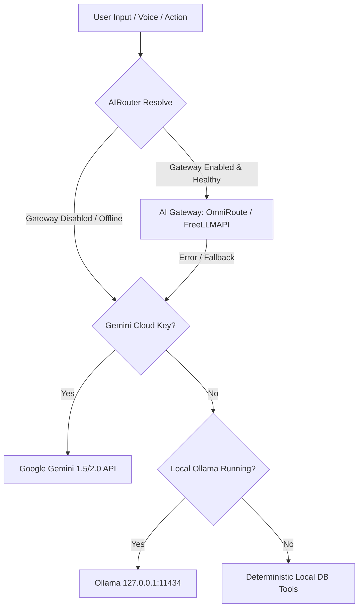

# Connecting OmniRoute & FreeLLMAPI to TADASHI LifeOS

TADASHI LifeOS includes native support for OpenAI-compatible AI Gateways via `GatewayProvider` in `js/assistant/ai-router.js`. This allows you to connect smart multi-provider routers like **OmniRoute** and **FreeLLMAPI** directly into TADASHI without writing code or modifying application files.

---

## 1. What are OmniRoute and FreeLLMAPI?

| Tool | GitHub Repository | Primary Role | Default Endpoint |
|---|---|---|---|
| **OmniRoute** | [`cheaper-inference/OmniRoute`](https://github.com/cheaper-inference/OmniRoute) | Unified AI gateway supporting 1,400+ models across free and paid providers, with context compression (RTK/Caveman) and quota-aware auto-fallback. | `http://127.0.0.1:8080/v1` |
| **FreeLLMAPI** | [`tashfeenahmed/freellmapi`](https://github.com/tashfeenahmed/freellmapi) | Local proxy that aggregates free developer API keys (Groq, Together, DeepInfra, Mistral, Google Gemini, OpenRouter, Cerebras) with automatic HTTP 429 failover. | `http://127.0.0.1:3001/v1` |

Both tools run on your local machine and expose a standard OpenAI-compatible API (`/v1/chat/completions` and `/v1/models`).

---

## 2. How to Launch Them on Windows PC

> [!TIP]
> **Windows PowerShell Note**: If PowerShell displays an error like `PSSecurityException: running scripts is disabled on this system`, use `npm.cmd` instead of `npm`, or run:
> ```powershell
> Set-ExecutionPolicy -Scope CurrentUser -ExecutionPolicy RemoteSigned
> ```
> Also make sure you run your commands from your Desktop or project directory (`C:\Users\HP\Desktop`), **not** from `C:\WINDOWS\system32`.

### Option A: Launching OmniRoute

Both source and zero-install `npx` options are supported:

**Method 1: Zero-Install NPX (Fastest)**
```powershell
npx --yes omniroute
```
*Starts OmniRoute on `http://localhost:20128/v1` (or `8080`).*

**Method 2: From Cloned Source**
Repository is cloned at `C:\Users\HP\Desktop\OmniRoute`:
```powershell
cd C:\Users\HP\Desktop\OmniRoute
npm.cmd install
npm.cmd run dev
```

---

### Option B: Launching FreeLLMAPI

Repository is cloned at `C:\Users\HP\Desktop\freellmapi`:
```powershell
cd C:\Users\HP\Desktop\freellmapi
npm.cmd install
npm.cmd run dev
```
*FreeLLMAPI starts listening on `http://localhost:3001/v1` with a web dashboard at `http://localhost:3001`.*

---

## 3. Connecting to TADASHI LifeOS

1. Open TADASHI LifeOS in your browser: **`http://localhost:8000/`**.
2. Navigate to **Manage (22 Domains)** → open **Settings & Voice** (or navigate to `http://localhost:8000/#settings`).
3. Under the **AI Gateway / Smart Router** card:
   - Click the preset button:
     - Click **⚡ OmniRoute** to auto-fill `http://127.0.0.1:8080/v1` and model `auto`.
     - Or click **🔄 FreeLLMAPI** to auto-fill `http://127.0.0.1:3001/v1` and model `auto`.
   - Toggle **Active Provider** switch to **ON**.
   - Optional: Enter your Bearer API key if your gateway requires one.
   - Click **Save Gateway**.
4. Click **Test Gateway Ping**:
   - TADASHI probes `${endpoint}/models` and displays a real-time status badge (e.g. `🟢 Online: 1400+ models ready`).

---

## 4. How the AI Router Hierarchy Works

When you chat with TADASHI (via the chat input, voice modal, or daily synthesis):



- **Tool Calling Support**: TADASHI passes its 22 domain tool declarations (`manage_tasks`, `manage_calendar`, `manage_fitness`, etc.) in standard OpenAI format. The gateway executes tools through TADASHI's policy engine and confirmation gates.
- **Failover Chain**: If OmniRoute or FreeLLMAPI rate-limits or fails, `AIRouter` automatically falls back to Gemini Cloud or local Ollama.
- **Privacy Mode**: In `local_only` mode, local loopback gateway instances (`127.0.0.1` or `localhost`) are strictly permitted while remote internet endpoints are blocked.
