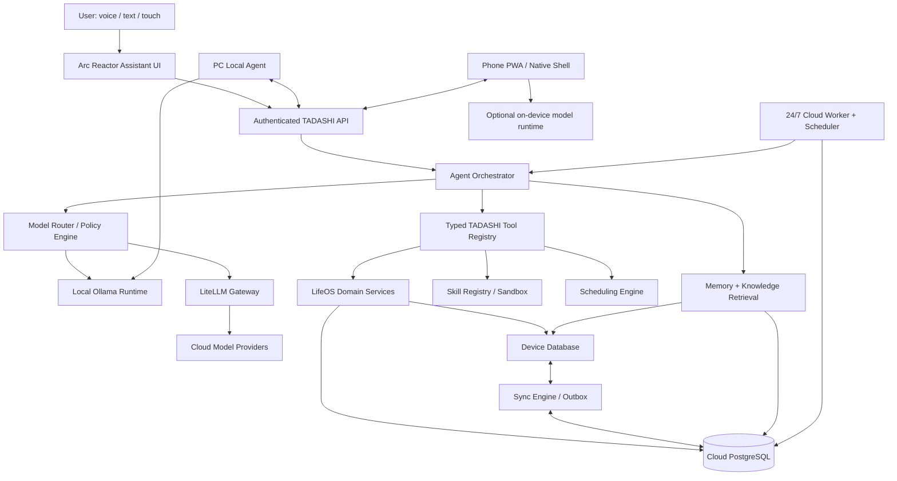

# TADASHI — Next-Generation AI Assistant Integration Specification

**Document type:** Product + technical integration specification  
**Version:** 1.0  
**Prepared:** 5 November 2026  
**Target repository:** `https://github.com/devloperksc-arch/life-assitant-ai`  
**Purpose:** A buildable specification for evolving TADASHI from a LifeOS dashboard with a Gemini chat panel into a voice-first, multi-model, hybrid online/offline personal AI operating system.

> This is an integration blueprint, not a claim that the features described below are already implemented. It is written to be added to the repository and used to plan implementation PRs. The repository assessment below is based on the supplied `Tadashi.zip` snapshot dated 3 October 2026; verify the live repository before changing or merging branches.

---

## 1. Product vision

TADASHI should feel like one persistent personal assistant, available from the PC and phone, with one identity, one permission system, one shared memory, and a consistent set of tools.

The user should be able to speak naturally and say things such as:

- “Tadashi, I have a meeting at 4. Move my study block somewhere useful.”
- “Find two free hours tomorrow and schedule DSA practice there.”
- “I am free after college. Plan my gym, dinner and project work without making the day unrealistic.”
- “Learn how to summarise my downloaded lecture PDFs and make that a skill.”
- “The internet is down. Show my tasks, log my workout and keep my day organised.”
- “Open my project dashboard and show what is blocking the next release.”

TADASHI must be able to **understand, propose, execute, verify and remember**. A model response alone is not a completed action.

### Core product principles

1. **One assistant, multiple engines.** Online and offline models use the same TADASHI tools and permissions.
2. **Offline-first operations.** Core personal data and essential actions remain available without a network connection.
3. **Cloud continuity.** The cloud service can run scheduled work when the PC and phone are closed.
4. **User-owned control.** Important actions are proposed first; permissions determine what may execute automatically.
5. **Skills, not uncontrolled self-modification.** TADASHI can acquire reviewed tools and workflows, but it must not silently rewrite its own production code or install arbitrary code.
6. **Explainability.** Every change has a source, a reason, a timestamp and an undo/rollback path where possible.
7. **Provider independence.** Switching from one AI provider or model to another must not require rewriting the LifeOS tools.

---

## 2. Existing repository baseline (supplied ZIP snapshot)

The supplied project is a useful starting point. Preserve its domain logic and visual work where practical.

| Existing path | What is present | Integration direction |
|---|---|---|
| `index.html` | Main app shell and script loading | Keep as the current entry point initially; add the Arc Reactor assistant shell and authenticated API bootstrap. |
| `js/app.js` | App bootstrap, layout and global UI setup | Add the global assistant mount point and app-level event integration. |
| `js/lib/ai.js` | Gemini-specific chat and function/tool definitions | Refactor behind a provider-neutral `AI Gateway` client and a central tool registry. Do not keep provider secrets in browser storage. |
| `js/lib/voice.js` | Browser Web Speech API speech-to-text and text-to-speech | Keep as a basic browser adapter; add provider adapters for reliable online and offline speech. |
| `js/db.js` | Domain data services backed by browser `localStorage` | Make this a local repository adapter; add an IndexedDB implementation and cloud sync adapter. |
| `js/data.js` | Seed/default data for LifeOS domains | Keep seed data, but migrate real user records through versioned migrations. |
| `js/pages/calendar.js` | Calendar rendering and event display | Keep the view; add availability, constraints, conflict checking and proposal workflows in a separate scheduling service. |
| `js/pages/tadashi.js` | TADASHI chat UI | Evolve into the Arc Reactor command interface and conversation/action timeline. |
| `js/router.js` | Frontend page routing | Expose safe navigation tools through the command registry; avoid giving the model arbitrary DOM access. |
| `css/main.css`, `css/components.css` | Existing design system | Extend with the Arc Reactor component and state animations. |

### Baseline limitations to address

- `js/lib/ai.js` is coupled to Gemini and contains the browser-side provider flow.
- The Gemini key is read from browser `localStorage`. Browser JavaScript and extensions running in the same origin can access it. Move provider credentials to a server-side secret store or a protected local agent.
- The current model tool loop executes tool calls directly. Add a policy/approval stage before state-changing or external actions.
- `js/db.js` persists the main application state in `localStorage`; this is not shared across devices and is not a robust offline sync queue.
- `js/lib/voice.js` relies on browser speech APIs. Speech recognition availability and offline behaviour vary by browser/platform; do not promise offline speech recognition based on this module alone.
- The current calendar operations are basic add/update/delete/list. “Find free time” and “reschedule around my constraints” need a scheduling engine, not just additional prompts.
- The supplied ZIP contains a Git configuration with a credential-like value in a remote URL. Revoke/rotate any credential that was exposed, remove it from repository history where appropriate, and use secret storage. Never copy secrets into this specification or source control.

**Do not merge all platform branches blindly.** First inspect current branch differences, establish a working baseline and make feature branches from the verified canonical branch.

---

## 3. Target system architecture



### System layers

**A. Client interfaces**
- Web/PWA interface for mobile and desktop browsers.
- PC desktop shell can be added later if OS-level control is required.
- Native Android shell or companion service is required for capabilities a normal browser cannot reliably access, especially background work and deeper Android integrations.

**B. TADASHI API and identity**
- Authentication, sessions, device registration and access control.
- API for LifeOS data, AI conversations, action proposals, skills and synchronization.
- Provider keys and privileged credentials never go to the browser.

**C. Agent orchestrator**
- Builds the relevant personal context for the current request.
- Selects an AI provider/model based on connectivity, task type, privacy and cost policy.
- Requests tool calls from the model, validates them and checks permissions.
- Executes approved tools, verifies results and records an audit event.
- Handles retries, limits, timeouts, cancellation and undo.

**D. Model infrastructure**
- Ollama for local models on the PC, and optionally an on-device runtime on mobile in a later phase.
- LiteLLM as the unified gateway for multiple hosted providers and model deployments.
- A provider-neutral TADASHI interface so neither the UI nor LifeOS domain code knows which model answered.

**E. Data and memory**
- PostgreSQL as the authoritative cross-device cloud database.
- IndexedDB for structured browser-local data, cached state and pending operations.
- SQLite for a PC companion/local agent if a native desktop process is introduced.
- Versioned sync events and conflict resolution.
- Separate memory layers for user facts/preferences, episodic events, project knowledge and acquired skills.

**F. Background execution**
- A cloud worker for reminders, recurring jobs and long-running plans.
- A device agent for local-only tasks and device-specific control.
- A service worker for PWA caching and supported background events; it is not a guaranteed always-running AI process.

---

## 4. Arc Reactor assistant interface

### Design goal

Create a recognisable central “Arc Reactor” presence: an animated circular intelligence core, concentric rings, a restrained cyan/blue glow, a dark graphite background and clear status changes. It should look futuristic without making essential controls difficult to use.

### Main interface layout

1. **Core reactor:** central animated circle with subtle rotating rings, energy arcs and a clear idle/listening/thinking/speaking/executing/error state.
2. **Conversation layer:** live transcript, user messages, assistant responses and action cards around or below the core.
3. **Input controls:** microphone/hold-to-talk, text input, stop speaking, cancel current task and attachments.
4. **Context strip:** current page, selected date, active project and the context TADASHI is allowed to use.
5. **Action proposal cards:** show the proposed action, affected records, reason, expected consequence and Approve / Edit / Reject controls.
6. **System status:** online/offline, active model, local model available, sync status and microphone permission.
7. **Quick commands:** “Today”, “Find free time”, “Plan my day”, “Open tasks”, “Learn a skill” and “PC controls” (only show controls available on that device).

### Reactor state machine

| State | Visual behaviour | User-facing label |
|---|---|---|
| `idle` | Slow low-intensity pulse | Ready |
| `listening` | Expanding waveform/ring reacting to voice | Listening |
| `transcribing` | Short moving signal around the ring | Understanding |
| `thinking` | Multiple rings rotate at different speeds | Thinking |
| `speaking` | Smooth pulse synced to audio amplitude where available | Speaking |
| `planning` | Rings assemble into a target/route pattern | Planning |
| `awaiting_approval` | Warm amber edge and visible proposal card | Needs your approval |
| `executing` | Progress arc and named operation | Working |
| `offline` | Dimmer local-only colour/state | Offline mode |
| `error` | Static interrupted ring; no endless spinner | Needs attention |

### Voice requirements

- Push-to-talk must be available even if wake-word support is added later.
- Show the recognised transcript before or while processing; allow correction.
- Support interruption: the user can stop TADASHI while it is speaking.
- Keep microphone state visible. Do not continuously record by default.
- Store voice preferences per user/device, not as provider credentials.
- Provide a text-only mode and keyboard navigation for accessibility.
- Separate speech-to-text and text-to-speech providers from the AI model provider.

**Important:** Browser `SpeechRecognition` is convenient but not a guaranteed offline speech engine. For reliable local speech, add a local STT/TTS adapter (for example, a tested Whisper-family or sherpa-onnx STT build and a local TTS engine) and verify performance on the actual target PC/phone. Treat these as optional providers, not assumptions.

### Suggested component structure

```text
js/
  assistant/
    reactor-ui.js          # render state and visual animation
    conversation-store.js # messages and active turn state
    voice-controller.js   # STT/TTS adapter selection
    action-card.js        # proposal / approval UI
    assistant-events.js   # app-wide events
```

The reactor is a UI for the agent; it must not contain the business logic for scheduling, permissions or data writes.

---

## 5. Full LifeOS control through a typed tool system

TADASHI must be able to control the entire website through named, typed tools. Do not let the LLM execute arbitrary JavaScript or manipulate arbitrary DOM elements.

### Tool categories

| Category | Example tools | Default permission |
|---|---|---|
| Read | `get_today`, `list_tasks`, `get_calendar`, `get_fitness_summary` | May execute automatically |
| Navigation | `navigate_to_page`, `open_record`, `search_lifeos` | May execute automatically |
| Reversible changes | `create_task`, `update_task`, `log_workout`, `add_calendar_event` | Auto only when user intent is explicit and policy permits; otherwise preview |
| External effects | `send_message`, `send_email`, `book_service`, `publish_content` | Explicit approval required |
| Destructive | `delete_record`, `reset_data`, `remove_skill`, `delete_file` | Strong confirmation; provide undo/backup where possible |
| Device controls | `open_application`, `set_volume`, `capture_screenshot`, `manage_files` | Per-device permission and explicit scope |

### Required tool execution flow

```text
User request
  -> intent + context extraction
  -> model proposes tool call(s)
  -> JSON/schema validation
  -> permission and risk evaluation
  -> conflict / precondition checks
  -> approval card if required
  -> execute through domain service
  -> verify persisted result
  -> audit log + undo record
  -> assistant reports the actual result
```

A model saying “done” is not proof. The tool service must return a verified result before the UI shows success.

### Example tool contract

```ts
export type RiskLevel =
  | "read"
  | "navigation"
  | "reversible_write"
  | "external_effect"
  | "destructive";

export interface ToolDefinition<TInput = unknown, TOutput = unknown> {
  name: string;
  description: string;
  inputSchema: object;       // JSON Schema
  risk: RiskLevel;
  requiredScopes: string[];
  execute(input: TInput, ctx: ToolContext): Promise<TOutput>;
}

export interface ToolContext {
  userId: string;
  deviceId: string;
  requestId: string;
  isOnline: boolean;
  approvedActionId?: string;
  abortSignal: AbortSignal;
}
```

### Minimum global tools

- `get_current_context`: current page, local date/time, device capabilities and online status.
- `navigate_to_page`: navigate to one of the allow-listed LifeOS routes.
- `search_lifeos`: search across user-authorised domains.
- `get_today`: tasks, appointments, routines and commitments for the current day.
- `get_availability`: return free/busy slots for a requested range.
- `propose_schedule`: create a draft schedule without committing changes.
- `apply_schedule_proposal`: apply a previously approved proposal.
- `undo_action`: undo a supported recent change.
- `get_sync_status`: show local/cloud sync state and pending operations.
- `list_skills`, `propose_skill_install`, `run_skill`, `disable_skill`.

All tools must be registered on the server or trusted local agent. The model can request tools; it cannot grant itself permissions.

---

## 6. Calendar intelligence: free-time detection and rescheduling

This is a core feature and needs its own scheduling service.

### Calendar data model additions

Every calendar item or time block should support:

```ts
interface ScheduleBlock {
  id: string;
  title: string;
  startAt: string;              // ISO 8601 with timezone
  endAt: string;
  type: "fixed" | "flexible" | "task" | "habit" | "buffer";
  status: "confirmed" | "tentative" | "completed" | "cancelled";
  priority: 1 | 2 | 3 | 4 | 5;
  movable: boolean;
  earliestStart?: string;
  latestEnd?: string;
  deadline?: string;
  estimatedMinutes?: number;
  minimumChunkMinutes?: number;
  preferredTimeOfDay?: "morning" | "afternoon" | "evening" | "any";
  energyRequirement?: "low" | "medium" | "high";
  location?: string;
  travelBufferBeforeMinutes?: number;
  travelBufferAfterMinutes?: number;
  source: "tadashi" | "external_calendar" | "user_import";
  externalId?: string;
  version: number;
}
```

Also store user preferences: usual sleep window, class/college/work schedule, meal windows, workout preferences, commute buffers, preferred focus duration, no-meeting periods, and which commitments must never be moved.

### Free-time algorithm

1. Resolve the requested date range and timezone.
2. Load confirmed fixed events, tentative blocks, recurring rules and user constraints.
3. Expand recurring events in the requested window.
4. Add buffers (commute, preparation, recovery) where configured.
5. Merge overlapping busy intervals.
6. Subtract busy intervals from the user's available waking window.
7. Filter slots by minimum duration, requested time of day and location constraints.
8. Rank slots by preference, energy fit, deadline pressure and disruption cost.
9. Return options with reasons; do not silently schedule anything.

### Rescheduling behaviour

When the user says “move my study session to my free time”:

- Identify the exact session and whether it is movable.
- Find valid alternatives before its deadline.
- Do not move fixed commitments or events owned by another person without permission.
- Minimise the number of calendar changes.
- Respect sleep, meals, college/work hours, commute and recovery buffers.
- Check that a new slot does not overlap another event.
- Present a before/after comparison, why the alternative was chosen, and any trade-off.
- Apply only after approval (unless the user has explicitly enabled a narrowly scoped auto-rescheduling rule).
- Keep an audit record and a rollback plan.

### Scheduling API

```text
GET  /api/schedule/availability?from=...&to=...&minMinutes=...
POST /api/schedule/proposals
GET  /api/schedule/proposals/:proposalId
POST /api/schedule/proposals/:proposalId/approve
POST /api/schedule/proposals/:proposalId/reject
POST /api/schedule/proposals/:proposalId/apply
POST /api/schedule/proposals/:proposalId/rollback
```

`POST /proposals` must return a draft proposal. It must not mutate live calendar events. The approval endpoint should bind approval to the user, proposal version and exact proposed changes.

### Example interaction

**User:** “I have a 90-minute study block tomorrow, but I need to go out at 5.”  
**TADASHI:** “You have a clear 10:30–12:00 slot and a 1:45–3:15 slot. The first leaves a larger buffer before you go out. Shall I move the study block to 10:30?”

Only after the user approves should the event be changed.

---

## 7. Self-learning and skill acquisition

“Self-learning” must be implemented as several explicit capabilities. It does not mean a model should be allowed to rewrite itself without review.

### Five learning layers

1. **Preference learning:** Remember corrections and durable preferences (for example, preferred workout times or how the user wants tasks prioritised). Store provenance and let the user inspect, edit or forget them.
2. **Episodic memory:** Remember important completed actions, decisions and project history with dates and links to source records.
3. **Knowledge acquisition:** Import user-approved PDFs, notes, websites and project documentation into a searchable knowledge base with source references.
4. **Procedural learning:** Turn a repeated process into a reusable, tested skill/workflow (for example, “summarise lecture PDFs into revision notes”).
5. **Model training/fine-tuning:** Optional advanced work. It is not needed for most new capabilities and must be separately planned, evaluated and versioned.

### What “acquire a skill” should look like

User says: “Learn how to turn my lecture PDFs into exam notes.”

1. TADASHI clarifies or infers a proposed outcome and input/output format.
2. It searches approved sources and the existing knowledge base.
3. It drafts a skill definition and workflow.
4. It generates or configures the implementation in a sandbox with no production secrets.
5. It runs test fixtures and validates output against acceptance criteria.
6. It shows the skill's actions, permissions, data access and limitations.
7. User approves installation.
8. TADASHI installs the versioned skill and records who approved it.
9. The skill can be run, disabled, upgraded or removed later.

### Skill manifest

Every skill must have a manifest similar to:

```yaml
id: lecture-pdf-to-revision-notes
name: Lecture PDF to Revision Notes
version: 1.0.0
description: Extracts a lecture PDF into structured revision notes.
entrypoint: skill.ts
runtime: sandbox
permissions:
  - files.read: user-selected-files
  - knowledge.write: tadashi-study-notes
network:
  allowed: false
secrets: []
inputs:
  - name: fileIds
    type: string[]
  - name: outputStyle
    type: string
outputs:
  - name: noteDocumentId
    type: string
risk: reversible_write
requiresApproval: true
tests:
  - fixtures/short-lecture.pdf
  - fixtures/scanned-notes.pdf
```

### Skill security requirements

- Skills run in a sandbox with explicit filesystem, network and domain permissions.
- No unrestricted shell, browser cookies, environment variables or credential access.
- Network access is denied by default; allow-list exact domains when needed.
- Validate input/output schemas and enforce time, memory and file-size limits.
- Scan dependencies and pin versions/checksums.
- Keep a human-readable changelog and test results.
- Require approval for install, permission expansion, external writes and updates to an installed skill.
- Log every skill execution and show which data it accessed.
- Support immediate disable and version rollback.
- Treat imported documents and web content as untrusted data, never as instructions that override system policy.

**Practical definition:** TADASHI “learns a skill” by acquiring a safe, testable capability and remembering how to use it. Fine-tuning model weights is a separate advanced feature, not the default method of learning.

### Suggested skill categories

- Document processing: PDF extraction, summarisation, note creation, file organisation.
- Study and research: flashcards, practice quizzes, source-based research, spaced revision.
- Scheduling: time-blocking, deadline planning, routine optimisation.
- PC productivity: approved app launching, file search, local scripts and project checks.
- LifeOS: meal planning, workout logging, expense categorisation and weekly reviews.
- Developer workflows: repo status, test execution, issue summaries and changelog drafting.

---

## 8. Ollama + LiteLLM: recommended multi-model strategy

### What each product does

**Ollama**
- Runs local models on a computer and exposes a local HTTP API (commonly `http://localhost:11434`).
- Supports chat, streaming, structured outputs, embeddings and tool/function calling for compatible models.
- Can also access Ollama-hosted cloud models using an Ollama API key.
- A local Ollama server is not the same thing as a universal aggregator for arbitrary OpenAI, Anthropic, Google and other provider API keys.

**LiteLLM**
- Provides a unified interface to many model providers.
- Can store provider credentials server-side and expose a single API to TADASHI.
- Supports model routing, retries/fallbacks, virtual keys, budgets and spend tracking depending on deployment/configuration.
- Can route to hosted providers and to a local Ollama deployment.

### Recommended arrangement

```text
TADASHI Agent Orchestrator
       |
       +-- Online / cloud route --> LiteLLM Gateway --> Gemini / OpenAI / Anthropic / other providers
       |
       +-- Local PC route --------> PC Local Agent --> Ollama --> local model
       |
       +-- Offline mobile route --> optional native on-device model runtime (later phase)
```

Do not make the cloud server call `localhost:11434` and expect it to reach the user's PC. `localhost` means the machine making the request. The PC needs a local agent that securely communicates with TADASHI, or the user must explicitly configure a secure private network tunnel. Do not expose the Ollama port directly to the public internet.

### Model routing policy

| Request type | Preferred route | Fallback |
|---|---|---|
| Read local tasks/calendar | Local service; model optional | Deterministic rules |
| Simple LifeOS commands | Local Ollama if available | Cloud model when online |
| Private notes / sensitive context | Local-only when user selects private mode | Ask before sending to a cloud provider |
| Complex planning / multi-step reasoning | Strong cloud model via LiteLLM | Best available local model with reduced capability warning |
| Web research / current information | Cloud provider + approved search tool | State that current research is unavailable offline |
| Offline task logging | Local domain service | Queue sync |
| Skill code generation | Sandbox; preferably strong model | Do not install without tests and approval |

A model router should consider **connectivity, privacy mode, task complexity, tool capability, latency, quota and cost**. It should not automatically send every message to the most expensive model.

### Provider-neutral interface

```ts
export interface ChatRequest {
  messages: Array<{ role: "system" | "user" | "assistant" | "tool"; content: string }>;
  tools?: ToolDefinition[];
  modelPreference?: string;
  privacyMode: "cloud_allowed" | "local_preferred" | "local_only";
  stream?: boolean;
}

export interface ChatResult {
  text?: string;
  toolCalls?: Array<{ name: string; arguments: unknown; callId: string }>;
  provider: string;
  model: string;
  usage?: { inputTokens?: number; outputTokens?: number };
}

export interface AIProvider {
  id: string;
  health(): Promise<{ available: boolean; detail?: string }>;
  listModels(): Promise<string[]>;
  chat(request: ChatRequest, signal?: AbortSignal): Promise<ChatResult>;
}
```

Create adapters such as `OllamaProvider`, `LiteLLMProvider` and later `BrowserLocalProvider`. The orchestration and tool execution layers must remain independent of provider-specific response formats.

### Example LiteLLM configuration (template only)

This is a starting illustration. Replace model names with currently available deployments and validate the exact provider syntax against the installed LiteLLM version.

```yaml
model_list:
  - model_name: tadashi-fast
    litellm_params:
      model: gemini/YOUR_FAST_MODEL
      api_key: os.environ/GEMINI_API_KEY

  - model_name: tadashi-reasoning
    litellm_params:
      model: openai/YOUR_REASONING_MODEL
      api_key: os.environ/OPENAI_API_KEY

  - model_name: tadashi-local
    litellm_params:
      model: ollama_chat/YOUR_LOCAL_MODEL
      api_base: http://127.0.0.1:11434

router_settings:
  # Configure tested fallbacks for each model group here.

 general_settings:
  master_key: os.environ/LITELLM_MASTER_KEY
```

> If LiteLLM runs inside Docker while Ollama runs on the host, `127.0.0.1` inside the container points to the container, not the host. Use a suitable private Docker network/host gateway address and keep it inaccessible from the public internet.

### Secrets policy

- Store provider keys in server environment variables or a secret manager.
- Never put Gemini/OpenAI/Anthropic/Ollama cloud keys in frontend JavaScript, HTML, IndexedDB or `localStorage`.
- Give clients a short-lived TADASHI session credential, not provider credentials.
- Use separate keys/budgets per service where supported.
- Redact secrets from logs and error reports.
- Rotate any key that has entered Git history or a shared archive.

---

## 9. Memory and knowledge system

Avoid one giant prompt containing every LifeOS record. Retrieve only what the current task needs.

### Memory types

| Type | Example | Storage/handling |
|---|---|---|
| Profile facts | Timezone, preferred language, durable preferences | Structured profile with editable fields |
| Preferences | Prefers a task checklist over a rigid timetable | Preference records with confidence and source |
| Episodic memory | A rescheduling decision from last week | Timestamped event records |
| Semantic knowledge | A note explaining a concept | Searchable knowledge chunks with citations |
| Project memory | TADASHI roadmap, issues and accepted decisions | Project-linked records and source links |
| Procedural memory | How the user wants a weekly review prepared | Versioned workflow/skill |

### Memory controls

- Show what was remembered and why.
- Let the user edit, export and delete memories.
- Add retention periods and sensitive-data exclusions.
- Store source/provenance and confidence for inferred preferences.
- Do not infer sensitive traits or treat an uncertain guess as a fact.
- Provide a “do not remember this” command.

---

## 10. Online/offline behaviour and sync

### Device behaviour matrix

| Situation | Expected capability |
|---|---|
| PC and phone online | Both use central API, shared database and cloud model routes. |
| PC offline, phone online | Phone continues with central intelligence; PC uses local services and local AI. |
| Phone offline, PC online | Phone uses cached data and offline-capable actions; PC remains connected. |
| Both offline | Each device can operate on its own cached/local data and local model if available. No cross-device sync until a connection returns. |
| PC turned off | Cloud reminders and cloud worker tasks continue. PC-only actions wait for the PC to reconnect. |
| Phone app closed | Cloud worker continues. Device-local background work is limited by Android/browser operating-system rules. |

### Sync design

- Use IndexedDB for browser-local domain data and an outbox of pending operations.
- Every write has a unique operation ID, entity ID, entity version, device ID and timestamp.
- Sync operations are idempotent; retrying an operation must not duplicate it.
- Use server-issued version numbers or revision IDs to detect stale writes.
- Resolve simple field conflicts deterministically only when safe.
- For conflicting schedule changes, money records, deletes or externally linked records, create a conflict item for the user instead of silently choosing.
- Keep a visible sync queue: pending, synced, conflict, failed.
- Never show “synced” until the server acknowledges the operation.

### Example sync event

```json
{
  "operationId": "uuid",
  "entityType": "task",
  "entityId": "task_123",
  "operation": "update",
  "baseVersion": 7,
  "deviceId": "device_pc_01",
  "createdAt": "2026-11-05T10:00:00+05:30",
  "patch": { "status": "done" }
}
```

### PWA/native boundaries

A PWA can cache the interface and support certain offline/browser events, but a service worker is not a reliable permanently running AI daemon. For always-on PC access or deeper phone integrations, use a separately installed local agent/native companion with explicit permissions. Local model inference on a phone depends on device hardware, runtime support, memory, battery and thermal limits; benchmark before promising it.

---

## 11. PC and phone control

### Website control

TADASHI can reliably control its own website through the typed tool registry: navigation, forms, records, dashboards, calendar and settings. This is the first priority.

### PC control

For operating-system-level features, create a separate PC Local Agent with:

- authenticated pairing with the TADASHI account;
- loopback-only local HTTP/WebSocket interface by default;
- explicit capability grants (files, applications, screenshots, shell, clipboard, notifications);
- per-action allow-lists and confirmation for sensitive operations;
- audit logs and an emergency stop;
- no arbitrary shell command execution from raw model output.

### Phone control

Start with the PWA: notifications where supported, app navigation, local cached data and browser share/file-picker flows. Add a native Android wrapper/companion only for approved integrations such as Android intents, selected file access or background scheduling. Do not promise full control over Android from a normal website.

---

## 12. Background agent and 24/7 operation

Run a persistent cloud worker for work that must continue when the user's devices are off.

### Worker responsibilities

- scheduled reminders and briefings;
- recurring weekly reviews;
- deadline and commitment monitoring;
- sync/cleanup/retry jobs;
- user-approved monitoring tasks;
- notification delivery;
- long-running research or document jobs with explicit scope and budgets.

### Execution lifecycle

```text
queued -> claimed -> running -> awaiting_approval -> completed
                         |              |
                         v              v
                       failed         rejected
```

Every job should have a unique ID, owner, schedule, trigger, idempotency key, retry policy, timeout, cost limit, action permissions and result record.

**Cloud worker versus device worker:** cloud jobs can run continuously on a server. PC-only jobs run only when the PC agent is online. Browser timers and service workers must not be used as the only 24/7 scheduler.

---

## 13. Suggested backend API surface

Initial REST API outline; use authenticated routes and validate all request/response schemas.

```text
POST   /api/auth/session
GET    /api/me
GET    /api/devices
POST   /api/devices/pair

POST   /api/assistant/chat
GET    /api/assistant/conversations/:id
POST   /api/assistant/actions/:id/approve
POST   /api/assistant/actions/:id/reject
POST   /api/assistant/actions/:id/cancel
POST   /api/assistant/actions/:id/undo

GET    /api/lifeos/:domain
POST   /api/lifeos/:domain
PATCH  /api/lifeos/:domain/:id
DELETE /api/lifeos/:domain/:id

GET    /api/schedule/availability
POST   /api/schedule/proposals
POST   /api/schedule/proposals/:id/approve
POST   /api/schedule/proposals/:id/apply

GET    /api/skills
POST   /api/skills/proposals
POST   /api/skills/proposals/:id/test
POST   /api/skills/proposals/:id/approve
POST   /api/skills/:id/disable

POST   /api/sync/push
GET    /api/sync/pull?cursor=...
GET    /api/sync/status

GET    /api/agent/jobs
POST   /api/agent/jobs
POST   /api/agent/jobs/:id/cancel
```

Do not expose internal admin routes to an ordinary client session. Apply rate limits and per-user quotas to AI and worker endpoints.

---

## 14. Suggested data entities

Minimum new database tables/collections:

- `users`, `sessions`, `devices`, `device_capabilities`
- `conversations`, `messages`, `agent_runs`
- `tool_definitions`, `action_proposals`, `action_approvals`, `action_audit_logs`, `undo_records`
- `ai_provider_configs`, `ai_model_registry`, `ai_usage_events`
- `memory_items`, `memory_sources`, `knowledge_documents`, `knowledge_chunks`
- `skills`, `skill_versions`, `skill_permissions`, `skill_tests`, `skill_runs`
- `schedule_blocks`, `availability_rules`, `schedule_proposals`, `schedule_conflicts`
- `sync_operations`, `sync_cursors`, `sync_conflicts`
- `background_jobs`, `job_runs`, `notifications`

Keep domain-specific LifeOS records in their own tables or a carefully typed domain store. Do not turn every domain record into unvalidated arbitrary JSON just to make AI tool calls easier.

---

## 15. Security, privacy and reliability requirements

1. Authenticate every client and local agent. Use TLS for all remote communication.
2. Store provider credentials only on trusted servers or protected local processes.
3. Never expose the Ollama local port or a LiteLLM admin/master key publicly.
4. Use least-privilege scopes for every tool and skill.
5. Separate read-only operations from writes and destructive actions.
6. Require approval for external communication, payments, purchases, public posts, account changes and irreversible deletes.
7. Use idempotency keys for write operations and background jobs.
8. Add CSRF protection where cookie-based sessions are used, secure cookie settings, rate limits and request validation.
9. Treat imported files, webpages, email, calendar descriptions and model outputs as untrusted data.
10. Keep auditable records of model/provider, tool, arguments (redacted where needed), approval, result and rollback.
11. Add cost limits and model usage limits; prevent unlimited agent loops.
12. Provide an emergency “Stop TADASHI” control that cancels active agent runs and pauses scheduled actions.
13. Provide export and deletion controls for user data and memory.
14. Back up the cloud database and test restore procedures.
15. Do not let self-created skills access secrets, change permissions or disable safety checks.

---

## 16. Recommended repository structure after refactoring

```text
Tadashi/
  client/
    web/                    # Existing HTML/CSS/JS app during migration
    pwa/                    # PWA manifest, service worker, offline assets
  server/
    api/                    # Authenticated API and domain endpoints
    orchestrator/           # Agent loop, context builder, policy checks
    tools/                  # Typed LifeOS tool registry and implementations
    scheduler/              # Availability and rescheduling engine
    skills/                 # Skill registry, validator and sandbox runner
    workers/                # Persistent background jobs
    sync/                   # Sync protocol and conflict resolver
  local-agent/
    pc/                     # Optional PC companion and Ollama adapter
    mobile/                 # Optional native Android companion later
  packages/
    contracts/              # Shared schemas/types
    ai-providers/           # Ollama, LiteLLM and future adapters
    domain/                 # Shared domain services and validation
  infra/
    docker/                 # Dev/prod compose files
    litellm/                # LiteLLM config templates (no secrets)
    migrations/             # Database migrations
  docs/
    TADASHI_NEXT_GEN_INTEGRATION_SPEC.md
```

This structure is a target, not a requirement to move every existing file immediately. Keep the current frontend working while introducing one layer at a time.

---

## 17. Delivery roadmap and acceptance criteria

### Phase 0 — stabilise the current application

- Fix current syntax/runtime errors and create a baseline test checklist.
- Remove exposed credentials and rotate any compromised keys.
- Establish one canonical branch; document differences between Android and desktop branches.
- Separate provider configuration from UI code.

**Done when:** the existing LifeOS opens reliably, data migration/export works, no provider key is stored in frontend storage, and baseline actions are tested.

### Phase 1 — Arc Reactor interface and voice loop

- Create the reactor component and visible state machine.
- Integrate it globally so it is accessible from every page.
- Connect existing chat and voice modules through a new controller.
- Add transcript, stop/cancel and action proposal UI.

**Done when:** user can speak or type from any LifeOS page, interrupt speech, see the transcript and observe each agent state without losing the current page.

### Phase 2 — safe central tool layer

- Move tool definitions to shared contracts and server-side registry.
- Add auth, validation, permissions, action proposals and audit trail.
- Refactor current 22-domain operations to call domain services.

**Done when:** the assistant can read all allowed domains, perform approved writes and prove the result from the database. Destructive/external actions are approval-gated.

### Phase 3 — scheduling intelligence

- Add time-block constraints, availability calculation, proposals and conflict checks.
- Add natural-language “find free time” and “reschedule” tools.
- Add rollback and tests for overlaps, timezones, recurring events and deadlines.

**Done when:** TADASHI proposes valid options, explains trade-offs and never changes a calendar event before the required approval.

### Phase 4 — cloud backend, identity and cross-device sync

- Add PostgreSQL, API authentication and device registration.
- Add IndexedDB local persistence and sync outbox.
- Add versioning and conflict UI.

**Done when:** a change made on PC appears on phone after sync; offline edits queue and sync exactly once; conflicts are visible and recoverable.

### Phase 5 — Ollama + LiteLLM hybrid routing

- Add Ollama adapter for local PC models.
- Deploy LiteLLM as a private gateway for selected cloud providers.
- Add model registry, privacy preference, fallback policy and cost limits.
- Evaluate each model for tool calling and structured outputs before enabling it.

**Done when:** the same approved TADASHI tools work with the chosen local and cloud models; switching models does not change the LifeOS tool implementation; keys stay server-side.

### Phase 6 — skills and memory

- Add structured memory and user review controls.
- Add skill manifests, sandbox, test runner, approval and rollback.
- Start with low-risk document and productivity skills.

**Done when:** TADASHI can draft a skill, test it in isolation, explain permissions and install it only after approval.

### Phase 7 — 24/7 worker and device companions

- Add persistent cloud scheduler/worker and notification delivery.
- Add PC local agent for local model and explicit OS actions.
- Evaluate native Android companion for permitted phone capabilities.

**Done when:** cloud jobs continue when devices are off; PC-only tasks wait safely for the PC; the phone and PC accurately display local/cloud status.

---

## 18. Initial milestone backlog (recommended first PRs)

1. `chore/security-baseline`: remove/rotate secrets, audit Git history and establish secret scanning.
2. `fix/app-baseline`: fix runtime issues and smoke-test every existing LifeOS domain.
3. `feat/assistant-shell`: add the global Arc Reactor shell and state machine with mock events.
4. `refactor/ai-provider-contract`: remove direct Gemini assumptions from the UI and introduce `AIProvider`.
5. `feat/tool-policy`: implement typed tool registry, risk classification, approval cards and audit results.
6. `feat/schedule-availability`: implement free/busy calculation and draft rescheduling proposals.
7. `feat/backend-auth-db`: add authenticated API, PostgreSQL and migrations.
8. `feat/offline-sync`: add IndexedDB outbox, versioning and conflict handling.
9. `feat/hybrid-ai`: add Ollama and LiteLLM adapters with tested routing.
10. `feat/skill-acquisition`: add manifests, sandbox, test/approval/install/rollback lifecycle.

Do not start with model fine-tuning or unrestricted PC automation. First build the tool, permission, data and verification foundations that make those capabilities safe.

---

## 19. Testing checklist

### Voice and UI
- [ ] Microphone denied: text mode still works and the error is explained.
- [ ] User interrupts TADASHI while speaking: audio stops immediately.
- [ ] Speech recognition unavailable: user can type and continue.
- [ ] Offline status is visible and does not show false cloud connectivity.
- [ ] Keyboard and mobile touch controls work.

### Tools and permissions
- [ ] Read tool runs without approval.
- [ ] Reversible write follows configured user policy.
- [ ] External and destructive actions require approval.
- [ ] Forged/unknown tool names are rejected.
- [ ] A model cannot grant itself a permission or call unregistered code.
- [ ] Successful tool result is verified before the assistant says “done”.
- [ ] Undo restores the previous state for supported operations.

### Scheduling
- [ ] Overlapping events are detected.
- [ ] Sleep, class/work, meals and travel buffers are respected.
- [ ] Fixed events cannot be moved by default.
- [ ] Timezones and daylight-saving transitions are handled.
- [ ] Recurring events expand correctly in a requested date range.
- [ ] Proposal does not change live calendar until approved.
- [ ] Concurrent calendar edit causes a version conflict, not silent overwrite.

### Hybrid AI and security
- [ ] Local model works without internet when installed and running.
- [ ] Cloud route is selected only when policy allows it.
- [ ] No provider key appears in browser storage, network responses or logs.
- [ ] Local Ollama endpoint is not publicly exposed.
- [ ] Provider timeout/failure produces a controlled fallback.
- [ ] Unsupported local model tool call is rejected safely.
- [ ] Token/cost budgets stop runaway jobs.

### Sync and workers
- [ ] Offline write is queued once and synced once.
- [ ] Duplicate sync submission is idempotent.
- [ ] Conflicting writes become visible conflicts.
- [ ] Cloud worker runs when all user devices are offline.
- [ ] Device-only job waits for device reconnection.
- [ ] Emergency stop cancels active runs and pauses new autonomous actions.

### Skills
- [ ] Skill proposal has a readable manifest and permission list.
- [ ] Skill runs in a sandbox with no implicit secret access.
- [ ] Network is blocked unless explicitly allowed.
- [ ] Failed tests prevent installation.
- [ ] User approval is required before installation or permission expansion.
- [ ] Installed skill can be disabled and rolled back.

---

## 20. Decisions to make during implementation

These are deliberate implementation decisions, not blockers to beginning Phase 0 or Phase 1:

- Which cloud provider(s) should be enabled first? Start with one reliable provider and add others through LiteLLM after the gateway is tested.
- Which PC operating system will the local agent target first? Build and test the first local agent on the main development PC.
- What local model and quantisation can the PC run with acceptable latency and memory use? Benchmark on the actual hardware rather than assuming a model will fit.
- Should the phone remain a PWA initially, or should an Android native shell be introduced after sync is stable? Start with PWA unless a required feature needs native APIs.
- Which calendar source is authoritative: TADASHI only, Google Calendar, Outlook or a combination? External calendar writes require OAuth and their own conflict rules.
- Which skills may run automatically? Begin with read-only and reversible local tasks; broaden permissions only after usage and audit testing.

---

## 21. Official technical references

Use the official documentation when selecting versions and implementing provider adapters. Provider APIs and model availability change; do not hardcode a model name from this document without checking current provider docs.

- Ollama API introduction and local/cloud base URLs: https://github.com/ollama/ollama/blob/main/docs/api/introduction.mdx
- Ollama authentication and API keys: https://github.com/ollama/ollama/blob/main/docs/api/authentication.mdx
- Ollama OpenAI compatibility: https://github.com/ollama/ollama/blob/main/docs/api/openai-compatibility.mdx
- Ollama REST API, tool calling and structured outputs: https://github.com/ollama/ollama/blob/main/docs/api.md
- Ollama tool support overview: https://ollama.com/blog/tool-support
- LiteLLM getting started: https://docs.litellm.ai/docs/
- LiteLLM supported providers: https://docs.litellm.ai/docs/providers
- LiteLLM request routing, retries and fallbacks: https://docs.litellm.ai/docs/proxy/architecture
- LiteLLM client setup and credential boundary: https://docs.litellm.ai/docs/proxy/client_setup/overview

---

## Final implementation direction

**Build the Arc Reactor interface first as the visible control centre, but build it on top of a safe, provider-neutral agent core.** Preserve the LifeOS domain modules. Then add the typed tool registry and scheduling service, move provider credentials behind a backend, introduce Ollama + LiteLLM, and finally add skills, memory, sync and always-on workers.

The end state is not “a chatbot that can click buttons.” It is a personal AI operating system that can reason, propose, act through permissioned tools, learn new tested workflows, remember user-approved context and continue operating across devices with honest online/offline boundaries.
